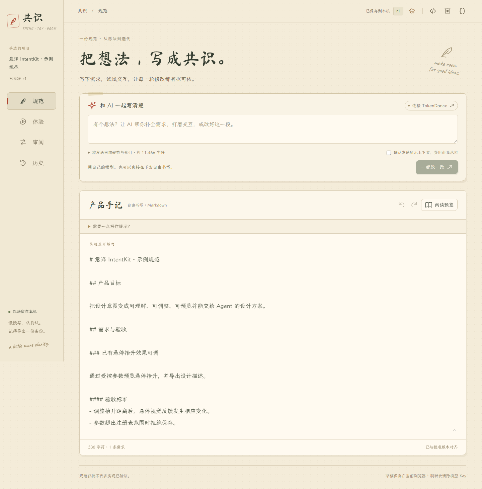

# 共识 Accord

**让想法与实现，始终对得上。**

和 AI 一起，把想法写清楚，把交互试明白，把每一轮决定留在同一份产品规范里。

[官网](https://accord-line.github.io/) · [打开工作空间](https://accord-line.github.io/accord/) · [English](README.en.md) · [Apache-2.0](LICENSE)

自由书写 Markdown PRD，用自己的模型提出修改，操作受控交互，审阅后批准，再导出 Codex 交接包。React + TypeScript + Vite 纯静态应用，IndexedDB 保存一个活动项目，无官方后端、账号、遥测或模型代理。

本轮根据用户反馈替换了 M1 的选择式表单：**正文直接编辑，BYOK 常驻首块，导航只有规范 / 体验 / 审阅 / 历史。** 代码、数据、JSON 协议收进右上角三个图标。

2026-10-15 视觉迭代：参考 IntentKit 的暖纸色、墨绿朱红、手写字与松弛布局。正文编辑 / 阅读切换显示；审阅默认显示变化，完整对照按需展开；连接设置移入弹层；组件属性在点击小笔后打开。新增手绘 SVG、秋雨点击、水波滑动与滚动反馈，右上角雨云图标可暂停，遵循系统减少动态偏好。详见 [本轮验证](docs/M5_VISUAL_VALIDATION.md)。本轮不代表 M5 全生命周期追踪计划已全部实现。

这是首个公开预览版（0.3.0-preview）。自由编辑、交互预览、人工批准、历史和交接已实现；M5 生命周期追踪仍在完善。真实模型目录及未认证跨域请求有历史验证记录，有效 Key 的付费调用不包含在自动化验收中。最新发布检查见 [发布记录](docs/ACCORD_RELEASE.md)，历史阶段结果见 [M4 验证报告](docs/M2_M4_VALIDATION.md)。



## 本地运行

Node.js 22.12+（本机 24.12.0）：

```sh
npm ci
npm run dev
```

打开终端地址，通常为 http://127.0.0.1:5173/。静态资源已加载后，手动编辑、预览、审批、导出无需联网或 Key。没有 Service Worker；首次离线打开/刷新不保证加载成功。

```sh
npm run check                 # lint、领域/存储/协议测试、类型一致性与构建
npx playwright install chromium firefox
npm run test:e2e              # 仓库子路径：Chromium / Firefox / 390px Chromium
npm run build:pages           # /accord/
npm run preview -- --base=/accord/
```

不同源的本机数据隔离，5173 与 4173 的草稿不共享，通过备份交换。默认 build 使用相对资源路径；自定义路径：`npm run build -- --base=/your-repo/`。dist 是静态交付目录。

## 无 Key 的一分钟流程

1. 直接在「规范正文」写 Markdown。可以任意分段、插入列表/表格/代码。展开写作提示可参考标题组织，**不必先选择卡片或字段**。
2. 如需结构化需求索引，用 `## 产品目标`、`## 需求与验收`、`### 需求标题`、`#### 验收标准`（列表）和 `#### 约束`。每次输入更新原文并排队自动保存，离开正文时同步索引，避免键入中间态立即删关联。非标准自由段落完整保留，不能自动理解的内容不猜测映射。
3. 在「体验」调节抬升距离/时长，再悬停或键盘聚焦卡片，视觉随参数改变。铅笔编辑组件属性与绑定；满意后「将当前参数写入草稿」。事件、动作、场景新增等完整声明式配置在右上角「项目数据」中编辑。
4. 「审阅」先看新增、移除与参数变化；需要时展开完整前后对照。填写审批说明后明确批准，才生成新 revision。候选可「继续编辑候选」转为工作草稿再改写；放弃/拒绝保留批准版。
5. 右上角「代码交接」导出批准内容的 ZIP；「项目数据」导出完整工作空间备份。**交接包与备份用途不同**，详见下文。

原始固定提案可从「项目数据 → 导入候选提案」打开 `examples/intentkit/custom-recipe.proposal.json`。它是可复现测试样例，不是真实模型响应。基线 r1 上批准后形成 r2，可操作新配方表单：空名称被阻止，合法名称和参数才可预览。

## BYOK：TokenDance 优先

首个适配依据用户提供的 [TokenPay 接入说明](https://agentuniverse.feishu.cn/wiki/IKnrwiDXRijdudkRb0WcCrCinIb) 与 [TokenDance PKCE 授权协议](https://tokendance.space/docs/api-key-oauth)。

1. 首块点「连接 TokenDance → 授权 TokenDance 钱包」，在服务商窗口自行登录并核对额度、有效期。Accord 不读取你的服务商登录凭据。
2. PKCE S256 verifier 与流程状态仅在本页内存。回调只携带一次性 code，验证来源、弹窗与状态后直连服务商交换 Key，立即清理回调地址。弹窗被拦截或不能返回时，打开无回调授权链接，将一次性 code 粘贴回原页（不要发聊天）；刷新后需重新开始授权。
3. 读取模型目录并核对支持 Chat Completions 的模型 ID。测试连接会发送一条短句，可能少量计费；不发送 PRD。**设置凭据不等于调用成功**。配置好后关闭连接弹层，回到首块描述想法。
4. 输入要求，展开实际发送上下文。确认接收服务、模型、字段和费用后生成候选。正文/模型/服务变化会使发送确认失效。不会自动重试或后台循环。
5. 模型仅能返回 Schema 白名单提案，先校验、模拟和检查引用，再人工审批。请求后手动编辑了正文/交互，旧候选会过期。结构化需求变化必须同步已有 Markdown，标准章节内容与索引不一致会阻止批准。

Key 仅在页面内存，不进 IndexedDB、localStorage、sessionStorage、文件、导出或日志。可以断开清除，刷新也清除。上下文明确发送给用户选择的第三方，受该服务政策约束。不要在聊天中发送 Key。

「已有 Key 或使用其他兼容服务」可配置 HTTPS 兼容端点、模型与临时 Key，本机调试允许 localhost HTTP。**只有允许浏览器跨域的服务才可纯 Web 直连**，没有官方代理。当前采用非流式 Chat Completions、模型默认 180 秒超时（可设置 15–600 秒；目录 20 秒、授权交换 30 秒）、生成上限 10000 output tokens（连接测试 32）；不支持协议时明确失败，不能宣称支持全部模型。

真实无认证探测：2026-10-15，Chromium 156 与 Firefox 157 从 localhost 读取目录各返回 106 个模型；无效 Key 的聊天返回可读取的 401、无效授权码交换返回可读取的 403。证据在 [BYOK_PUBLIC_PROBE.json](docs/BYOK_PUBLIC_PROBE.json)。这**不证明有效授权、付费调用或有效提案已成功**，也不替代线上 Pages 域的验证。模拟测试全部独立标明 simulated。

用户本机曾报告授权后请求超时。当前已增加阶段/耗时与无 Key 失败记录，模型等待上限可调；这不等于上游超时根因已解决。详见 [超时修订](docs/BYOK_TIMEOUT_FIX.md)。

## 数据、版本与恢复

正文、需求、体验和历史来自同一个工作空间领域对象。原文放在 `unstructuredNotes` 的保留标记条目中，产品 Schema 仍为原始 0.1.0。需求索引不是正文全部含义的替代品。协议见 [WORKSPACE_FORMAT.md](docs/WORKSPACE_FORMAT.md)。

IndexedDB 自动保存约延迟 300ms，顶栏显示保存状态。每次写入在同一事务比较 generation；多标签页冲突停止写入，提供本页备份和载入最新版本。审批必须持久化成功才显示新版本。损坏记录可导出、另存副本再明确恢复，不自动清库。浏览器清理仍可能丢失本地数据，请定期备份。

工作空间/文件上限 8 MiB，ZIP 最多 32 项、声明解压总量 16 MiB、文本实际读取上限 8 MiB；拒绝 ZIP64、加密、路径穿越、未知条目、恶意键与超深数据。撤销/重做最多 100 步，批准快照最多 500，审阅记录最多 2000。大正文与大量历史可能先到工作空间体积限制，错误时保留当前内存内容供备份。

旧 M1 备份仍可导入，旧未完成表单有显式合并/放弃入口。Proposal v0.2 仅增可选 `updateDocument`，旧操作兼容；迁移与回归见 [协议说明](docs/WORKSPACE_FORMAT.md)。

## 给 Codex 的交接

```text
README.md / AGENTS.md / CODEX_TASK.md
workspace.json                         批准版镜像与批准快照，可重导入
product-spec/project.spec.json         严格校验的 approved
product-spec/project.json              同内容别名
product-spec/requirements.md           完整批准 Markdown
product-spec/experiences.json
product-spec/changes.json / decisions.json / evidence.json / validation.json
schemas/                              项目与提案协议
drafts/                               只有主动勾选时另附，明确未批准
```

默认不混入当前工作草稿、未批准提案或撤销栈。重导入交接包默认打开批准版本；选附的 drafts/ 是独立附件，可把其中 `workspace.draft.json` 单独导入以恢复工作草稿。完整备份则保留全部工作区状态。

`node scripts/verify-handoff.mjs` 会以**固定样例**生成 r2 交接演示、实际解包并校验重导入等价。当前示例已交给本次 Codex 读取，另附针对真实 IntentKit commit 的 [实现和测试计划](docs/INTENTKIT_IMPLEMENTATION_PLAN.md)。没有修改原仓库、提交、推送或部署。

Pages 工作流 `.github/workflows/pages.yml` 在 main 更新或手动触发时构建并发布 `/accord/` 工作空间；官网位于独立的 `Accord-Line/accord-line.github.io` 仓库。当前发布记录见 `docs/ACCORD_RELEASE.md`；生产域下有效 Key 的计费调用需单独验收。原始代码采用 Apache-2.0，运行时包与字体的许可汇总见 THIRD_PARTY_NOTICES.txt，随 dist 携带。

## 验证与文档

- [本轮验证与未测范围](docs/M2_M4_VALIDATION.md)
- [UX 改版与实际走查](docs/UX_REDESIGN.md)
- [安全边界](SECURITY.md) · [贡献说明](CONTRIBUTING.md) · [English](README.en.md)
- M0/M1 报告与截图保留为历史，旧表单 E2E 源码另存 `.archive`，本轮浏览器测试对应最新 Markdown 界面。

结构通过、本地场景通过和外部实现通过是三种不同证据。界面预览不会自动把测试标为 passed。Safari、真实用户测试、线上部署、有效模型生成尚无通过结论。

## 名称、协议与开源许可

品牌名为 **共识 Accord**。Product Specification Workspace / PSW 是开发阶段名称；旧 Schema ID、IndexedDB 名称和 ZIP 文件前缀继续保留，用于兼容既有数据，品牌更新不会迁移或清空用户草稿。

原始代码采用 [Apache-2.0](LICENSE)，见 [NOTICE](NOTICE)。第三方包保留原许可，完整文本在 `THIRD_PARTY_NOTICES.txt`；自托管字体的 SIL OFL 文本和来源在 `public/fonts/`。IntentKit 是独立的案例与视觉参考项目，其所有权和许可证保持原样。
