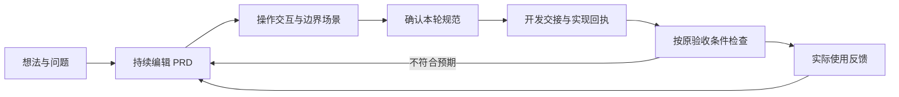

# M5 产品方案：贯穿产品周期的可交互 PRD

日期：2026-10-15。状态：设计方案，尚未实施。本文件不批准用户页面上的候选提案，不修改当前 approved，不代替真实模型或原仓库的验收证据。

## 1. 目标与当前证据

任务句（S）：产品负责人从提出想法、讨论交互，到开发交接、验收和收集反馈，都围绕同一份持续更新的 PRD 工作；能随时回答“为什么做、应该怎样表现、实现到了哪里、根据什么确认、接下来改什么”。

本轮输入是用户对 M5 的产品问题与页面截图。截图显示已有结构合法候选返回、当前批准 r1、候选尚待审阅。这是用户提供的页面状态，不能据此独立确认全部模型调用、语义正确性或功能实现完成。截图中的 AI 提案文字视为待审内容，不作为用户授权指令。

已核实代码：已有 Markdown 正文、需求/体验/测试关联、批准 revision、审阅记录、版本快照、有限声明式运行时和批准内容的交接导出。当前 Workspace 没有覆盖实现回执、逐项验收、反馈归因与证据过期的完整周期记录。交接文件要求 Agent 返回结果，但还没有完整的结果回流入口。

设计推断：用户能够写和导出 PRD，但“正文、交互、交接结果、验收”之间的联系仍主要需要自己记住。M5 的重点是让这些联系可操作、可追溯。没有新用户研究或线上指标，不宣称已经证明流失原因或改版效果。

## 2. 产品主张

**每条需求都能被讨论、被体验、被交付、被验证，并带着反馈进入下一轮。**

周期是可来回工作的关系，不做必须依次点完的向导。所有关联最终回到同一个需求与批准版本。运行中的产品可以同时有已验收的旧需求、开发中的改动和待讨论的新想法，不强行赋予全项目一个完成阶段。

## 3. 用一个需求贯穿全部操作

示例：“用户能创建自己的配方，调整参数后预览，失败时保留输入并恢复”。以下是拟议验收任务，不是已运行结果。

| 周期 | PRD 中实际承载的内容 | 用户能执行的动作 | 留下的结果 |
|---|---|---|---|
| 定义问题 | 谁遇到什么问题、目标、边界与验收条件 | 自由写 Markdown，让 AI 提问、补全或提出修改 | 需求草稿与讨论依据 |
| 讨论交互 | 触发、界面响应、异常和恢复方式 | 在正文旁试输入、调参、提交；切换空输入、等待、超时、成功场景 | 与该需求关联的体验和待解决问题 |
| 确认范围 | 本轮接受哪些文字与交互改动 | 对照修改前后，继续编辑或明确批准 | 可交接的批准版本 |
| 实现交接 | 同一需求、交互约定、原验收条件 | 导出给 Agent，导入实现回执 | 对应需求的文件改动、commit、测试命令与实际结果 |
| 验收发布 | 对照本轮目标检查实际实现 | 逐条运行/核对证据，确认通过或记录差异 | 可追溯的验收结果与发布记录 |
| 使用迭代 | 用户遇到的问题、期望与实际行为 | 把反馈关联到原需求，形成下一轮候选修改 | 反馈来源、变更理由与新版本 |

交互的价值包括“怎么失败、怎么恢复”，例如超时后输入是否保留、是否重复请求、用户是否知道下一步。视觉参数预览继续保留，同时增加可讨论的行为场景。

## 4. 页面结构：保持克制

主导航建议仍为四项：**规范 / 体验 / 验收 / 迭代**。审阅作为正文与候选修改旁的就近动作；版本历史、变更决策和反馈进入迭代页。代码交接、机器数据与 JSON 协议继续使用角落图标。

### 规范页

首块保留 AI 协作。正文始终可自由编辑 Markdown，不要求先选阶段或需求卡片。正文标题附近增加一条轻量的“本轮目标与下一步”，只读取真实周期数据，不显示虚构百分比。

示意文案：“本轮目标：模型调用失败后可恢复 · 下一步：验证超时场景”。这是示例，不是当前项目的实际状态。

桌面右侧为可收起的关联面板，跟随当前段落/选区显示：相关体验、待确认问题、实现回执和验收结果。正文旁出现简短的“体验此交互”“查看验收依据”入口。手机使用底部抽屉，保持正文可编辑。无需在正文里填写代码 ID 或 JSON。

### 体验页

提供与需求关联的正常、空输入、等待、超时、失败恢复等场景入口；实际范围由该体验声明的状态/动作决定。不支持的行为明确说明。用户先操作场景，再决定是否把观察转成规范修改。

“运行演练”只操作本地受控状态，不暗中发起计费模型请求。真实模型验收使用独立、明确的请求入口。模拟演练与真实请求结果分别显示来源。

### 验收页

按用户写下的验收条件组织，显示预期、实际观察、证据来源、对应版本与结论。允许“尚未验证 / 符合 / 不符合 / 需要重新验证”，结论需要具体依据。人工说明可作为人工记录，但不能替代可核对的执行结果。

需求旁用两条独立事实表达状态，例如：“规范已确认 · 实现待验收”。批准规范、模型返回、声明式预览通过和真实实现通过分别记录。

### 迭代页

以一轮目标组织反馈、候选、批准、交接、验收与发布记录。能追问“为什么改、改了哪里、当时根据什么决定”。失败验收和使用反馈可以关联到既有需求，形成下一轮候选，避免重复抄写一份新 PRD。

## 5. AI 贯穿周期的职责

| 当前工作 | AI 可以协助 | 接受边界 |
|---|---|---|
| 梳理想法 | 补充问题、澄清目标和边界 | 人工决定目标 |
| 讨论交互 | 提出体验、异常与恢复候选 | 通过白名单校验，实际演练后人工确认 |
| 变更范围 | 解释哪些体验、测试与交接受影响 | 先显示依据，不自动改变批准版 |
| 开发交接 | 为已批准需求生成任务和测试计划 | 编辑真实仓库仍按用户授权范围执行 |
| 结果验收 | 对照原条件找缺项、整理已有运行记录 | 不自行创造运行证据或标记实现通过 |
| 反馈迭代 | 归并反馈、提出修订和回归范围 | 新一轮候选经过审阅 |

当前模型、服务地址、发送范围、费用、取消和仅内存 Key 的约束继续保留。阶段变化不触发后台模型调用。缺少 Key 时所有手动周期操作仍可用。

## 6. 先补齐两个基础能力

### 稳定的正文关联

已有标题/位置推断不足以长期承载实现证据。M5 应为需求正文提供稳定关联，保存在机器层；人仍自由书写。改名或移动段落后，交互和回执应继续指向同一需求。整段粘贴/改写导致身份不明确时，保留原证据并提示核对，不静默挂到另一个需求。

具体 Markdown 编辑器和关联算法需实施前单独验证，不能只因添加一个 ID 字段就宣布解决身份问题。

### 证据与版本绑定

每条回执/验收记录关联需求、批准 revision、被验证的交互内容、来源、时间和结果；外部实现记录补充目标仓库/commit。历史记录保留。

若只修改无关段落，不把所有验收标记失效；若变更相关需求、验收条件或交互，标记对应结论“需要重新验证”。单纯不匹配版本也不能直接声称功能失败。精确影响判断不确定时明确提示人工核对，不能无依据传播通过状态。

生命周期合同应形成可迁移的独立记录层，继续引用现有规范 ID，不另造第二份需求事实来源。正式字段、Schema 版本和旧文件迁移在实施时一起提交。机器格式仍在角落工具，不暴露成主写作表单。

## 7. M5 建议范围与验收

| 编号 | 优先改动 | 可观察的验收条件 |
|---|---|---|
| M5-01 | 正文关联体验与稳定身份 | 改名、移动一个需求，相关体验/证据仍能找到；身份不确定时提示且不丢记录 |
| M5-02 | 行为场景演练 | 在同一需求旁试正常、错误和恢复；操作真实影响受控状态；模拟不发真实付费请求 |
| M5-03 | 交接结果回流 | 导入一个带需求 ID/批准版/commit/命令结果的回执，能跳回原验收条件；错误/过期回执不直接宣布通过 |
| M5-04 | 验收与证据过期 | 某次验收通过后修改相关行为，该项显示需要重新验证；旧证据保留；无关需求不被一律失效 |
| M5-05 | 反馈进入下一轮 | 一条失败验收或实际使用反馈，关联原需求并生成待审修订，批准形成下一版 |
| M5-06 | 完整周期往返 | 导出、重导入后，正文、体验、回执、验收、反馈、版本关联均保留；无 Key 也能手动跑通 |

首个完整验收故事：**创建自定义配方 → 试空名称与合法参数 → 批准规范 → 导出交接 → 导入实现回执 → 核对预览/导出结果 → 从一次失败反馈修订并重新验证。**

真实 BYOK 验收作为这套能力的一个案例：记录当次请求、返回候选、语义检查、场景操作和人工接受；不能仅新增一个“验收表单”就将模型功能标为通过。

实施顺序建议：先完成稳定关联和正文旁演练，再完成回执/验收与过期规则，最后打通反馈修订和全量文件往返。每步分别给出实际验证结果。

## 8. 设计来源、走查与未验证项

来源标签来自已使用的 ui-ux-first-value 方法：S 为本轮综合方案；K4 为选择清晰度启发；E2 为注意力/反馈启发；W4 为组件一致性启发，均不作为效果数据。

| 位置 | 修改与理由 | 标签 | 验收方式 |
|---|---|---|---|
| 首屏 | 任务说明、AI、本轮目标、正文；让下一步与正在写的内容相连 | E2 → S | 用户可说清本轮目标与未完成事项 |
| 正文旁 | 关联体验/证据，面板可收起；手机抽屉 | K4 → S | 不离开原需求能试交互并找到结果 |
| 四项导航 | 规范、体验、验收、迭代；审阅就近出现 | K4/W4 → S | 不增加主菜单数量，待审修改仍易找到 |
| 状态 | 同时写清规范确认与实际实现，不靠单一颜色/总进度 | S | 人能区分草稿、演练、真实验收与过期证据 |
| 异常反馈 | 输入保留、请求取消、是否有执行结果与下一步 | E2 → S | 走完失败→恢复→返回原规范 |

本轮执行的是截图与源码审查、上述单需求的文字走查，**未执行 M5 原型浏览器走查或用户测试**。现有 M4 自动化结果不能改称 M5 已通过。仍需验证：自由 Markdown 的稳定身份、面板跟随是否打扰写作、390px 抽屉操作、回执可信来源、版本影响判断、有效 Key 模型生成和完整周期持久化。

后续可让 3–5 位目标用户独立完成一个完整任务，记录寻找入口、误解状态、证据误关联和是否能完成下一轮修订；没有参加者数据前不提供完成率或效率提升数字。
